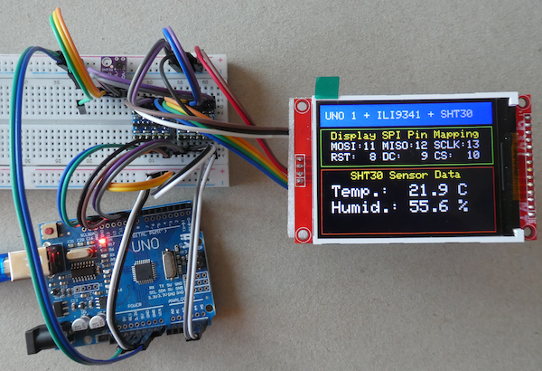
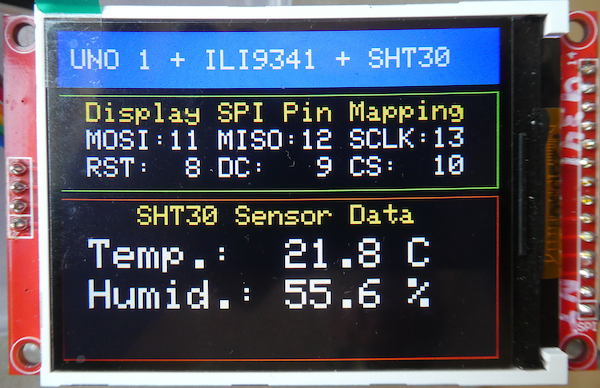

# Arduino UNO R3 with ILI9341 TFT Display and SHT30 Environment Sensor

This repository accompanies the article "**Connect an ILI9341 TFT Display and SHT30 Environment Sensor to an Arduino UNO R3**" published here:

## Hardware used for the project

- an Arduino Uno 3 clone,
- an ILI9341 TFT display (2.8-inch screen, 240 x 320 pixel resolution, SPI interface),
- an SHT30 sensor module with an I2C interface,
- and two 4-channel level shifter modules.

**A word of urgent warning right at the start: please never connect a display or sensor to an Arduino UNO before familiarizing yourself with the technical details of your hardware - otherwise, you could destroy your devices.**



## Wiring

### SPI (Display) Interface
````plaintext
MOSI: 11
MISO: 12
SCLK: 13
RST:   8
DC:    9
CS:   10
````

### I2C (Sensor) Interface
````plaintext
SDA:  A5
SCL:  A4
````



## Development Environment (Arduino)
````plaintext
Arduino IDE Version 2.3.10 (MacOS)
Arduino AVR Boards Version 1.8.8
Adafruit ILI9341 library version 1.6.4
Adafruit SHT31 library version 2.2.2
````
